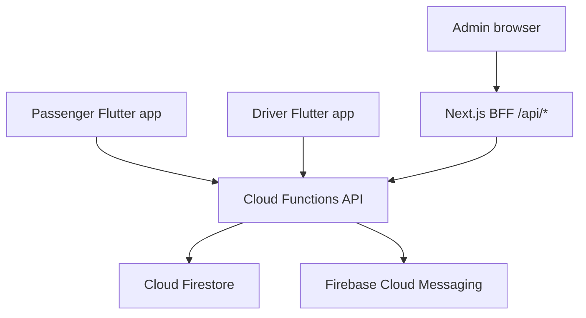
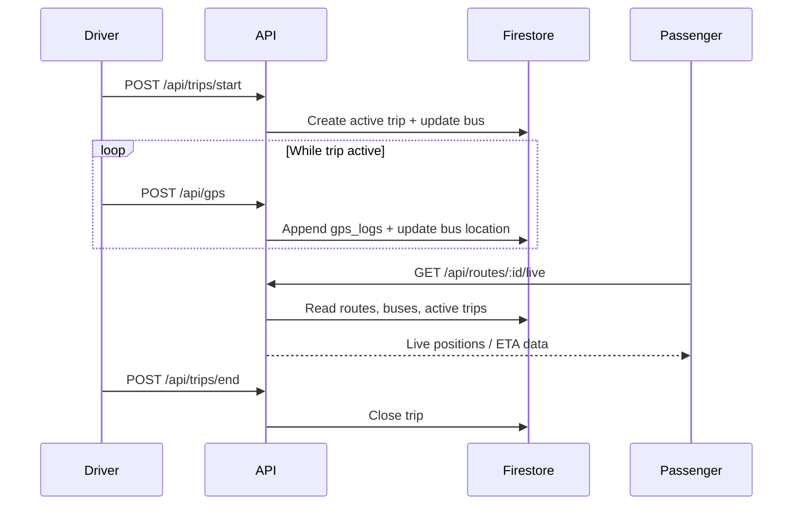

# TRDDK — Bus Tracking Platform

**ترددي (TRDDK)** منصة متعددة المستأجرين لتتبّع الباصات وتشغيلها.

**TRDDK** is a multi-tenant bus tracking and operations platform. The codebase still uses the legacy identifier **`tardadi`** in package names and some paths. iOS bundle IDs are registered in App Store Connect and cannot be changed.

## What this repository contains

| Component | Technology | Path | Role |
|-----------|------------|------|------|
| Passenger app | Flutter (Dart ^3.11.5) | `apps/passenger` | Riders view routes, live buses, reminders, notifications |
| Driver app | Flutter (Dart ^3.11.5) | `apps/driver` | Drivers start/end trips, send GPS, view assigned route |
| Admin panel | Next.js 15 + React 19 | `apps/admin` | Super/business admins manage businesses, routes, buses, drivers, trips |
| HTTP API | Cloud Functions Gen2 + Express | `firebase/functions` | REST API, auth, Firestore access, routing helpers |
| Shared TS contracts | TypeScript | `packages/shared` | Types, constants, RBAC, API client for Admin + Functions |
| Shared Flutter library | Dart | `packages/tardadi_core` | API client, models, maps, theme, FCM helpers |

**Production Firebase project (current):** `trddk-54c45` · **Region:** `us-central1`

> Do **not** point local or production config at the old project `tardadi-5bd8e` (not referenced in this repo).

## Architecture

Admin uses a **Next.js BFF**: the browser calls `/api/*` on the Admin host; server routes proxy to Cloud Functions with service-account auth where required.



## Trip flow (simplified)



## Repository layout

```
apps/
  passenger/          # Flutter passenger app
  driver/             # Flutter driver app
  admin/              # Next.js admin panel (source of truth)
firebase/
  functions/          # Cloud Functions Express API
  firestore.rules     # Security rules
  firestore.indexes.json
packages/
  shared/             # TypeScript shared package (@tardadi/shared)
  tardadi_core/       # Flutter shared package
scripts/              # Setup, emulators, deploy helpers, seed
docs/                 # Setup, API, deployment, and auth notes
```

## Requirements

Extracted from project files (verify locally with `node -v`, `flutter --version`):

| Tool | Version / note |
|------|----------------|
| Node.js | >= 20 (`package.json` engines; Functions `node: 20`) |
| npm | Workspaces monorepo (root `package.json`) |
| Flutter | SDK ^3.11.5 (`apps/*/pubspec.yaml`) |
| Firebase CLI | Used for emulators, deploy (`firebase-tools` in root devDependencies) |
| FlutterFire CLI | Optional — `scripts/configure-flutterfire.sh` |
| Java | 21 recommended for Android builds (see `docs/setup.md`) |
| Xcode / CocoaPods | iOS builds (`scripts/setup-ios.sh`) |

## Quick start (development)

```bash
# 1. Install JS dependencies and build shared package
npm install
npm run build:shared

# 2. Functions env (emulator)
cp firebase/functions/.env.example firebase/functions/.env

# 3. Admin env (local)
cp apps/admin/.env.example apps/admin/.env.local
# Set TARDADI_API_URL to emulator URL (see .env.example)

# 4. Start emulators (Firestore + Functions)
npm run emulators

# 5. Admin (separate terminal)
npm run dev:admin

# 6. Flutter apps
npm run setup          # optional full bootstrap
cd apps/driver && flutter pub get && flutter run
cd apps/passenger && flutter pub get && flutter run
```

See **[docs/setup.md](docs/setup.md)** for full setup, emulators, and troubleshooting. Android Studio steps are in **[docs/setup-android.md](docs/setup-android.md)**.

## Environment variables

No real secrets in git. See **[docs/setup.md](docs/setup.md)** and `apps/admin/.env.example`, `firebase/functions/.env.example`.

| Variable | Secret? | Local | Production |
|----------|---------|-------|------------|
| `TARDADI_API_URL` | No | Emulator URL | Cloud Functions URL |
| `ADMIN_JWT_SECRET` | **Yes** | Dev only | Secret Manager |
| `GOOGLE_MAPS_API_KEY` | Restricted | Optional | Required for maps/geocode |
| `NEXT_PUBLIC_GOOGLE_MAPS_*` | Public, restrict by referrer | Optional | Required for Admin maps |
| Firebase `NEXT_PUBLIC_*` | Public client config | From Firebase console | App Hosting / env |
| SMTP_* | **Yes** | Optional | Required for password reset email |

## Firebase

| Item | Value |
|------|--------|
| Project ID | `trddk-54c45` |
| Region | `us-central1` |
| Firestore | `(default)` database |
| Functions export | Single HTTPS function `api` |
| Admin deploy target | See `docs/deployment.md` and `docs/canonical-deployment.md` |

Details: **[docs/firestore.md](docs/firestore.md)**, **[docs/deployment.md](docs/deployment.md)**.

## Tests

```bash
npm run typecheck                    # All TS workspaces (if configured)
cd apps/admin && npm run typecheck && npm run build
cd firebase/functions && npm run typecheck && npm run build
cd packages/tardadi_core && flutter test
cd apps/passenger && flutter analyze && flutter test
cd apps/driver && flutter analyze && flutter test
```

## Deployment

Summary: **[docs/deployment.md](docs/deployment.md)** and **[docs/canonical-deployment.md](docs/canonical-deployment.md)**.

## Known issues (verified)

| Issue | Status | Notes |
|-------|--------|-------|
| Admin production maps show Carto **"API KEY REQUIRED"** watermark | Open | `NEXT_PUBLIC_GOOGLE_MAPS_*` not set on App Hosting; falls back to Leaflet + Carto tiles |
| Admin logo missing on some production hosts | Check | Sidebar uses `public/icons/trddk-wordmark.png` and `public/icons/tardadi-bus-mark.png` |
| SMTP not configured | Open | Password reset returns server error until SMTP secrets are set |
| Cloud Run public invoker blocked by org policy | By design | Admin BFF uses service account to call API; browser must not call Cloud Functions directly |
| Minimal automated test coverage | Open | Only `tardadi_core` has substantive unit tests |

## npm scripts

| Script | What it runs |
|--------|----------------|
| `npm run build:shared` | Build `@tardadi/shared` |
| `npm run build:functions` | Build Cloud Functions |
| `npm run dev:admin` | Next.js admin |
| `npm run dev:backend` | Local backend |
| `npm run dev:driver` / `dev:driver:ios` | Driver app on the iOS simulator |
| `npm run dev:driver:android` | Driver app on Android |
| `npm run dev:passenger` / `dev:passenger:android` | Passenger app on Android |
| `npm run dev:passenger:ios` | Passenger app on the iOS simulator |
| `npm run dev:android:emulator` | Open the Android emulator helper |
| `npm run setup` | Install JS deps, build shared, and `flutter pub get` |
| `npm run setup:ios` | iOS setup |
| `npm run emulators` | Firestore and Functions emulators |
| `npm run typecheck` | Typecheck workspaces that define the script |

## Branches

`main` is stable. Other branches use `feature/<app>-<short-desc>`, `fix/<app>-<short-desc>`, `chore/<desc>`, or `docs/<desc>`. `<app>` is `admin`, `driver`, `passenger`, `backend`, or `shared`. Details: **[CONTRIBUTING.md](CONTRIBUTING.md)**.

## Documentation index

The full list is **[docs/README.md](docs/README.md)**.

| Document | Purpose |
|----------|---------|
| [docs/setup.md](docs/setup.md) | Local setup and debugging |
| [docs/setup-android.md](docs/setup-android.md) | Android emulator setup |
| [docs/api.md](docs/api.md) | HTTP API reference |
| [docs/deployment.md](docs/deployment.md) | Deploy checklist |
| [docs/auth.md](docs/auth.md) | Auth migration |
| [CONTRIBUTING.md](CONTRIBUTING.md) | Branch, commit, and review rules |

## Mobile bundle IDs

| App | iOS | Android |
|-----|-----|---------|
| Passenger | `com.tardadi.trddk.passenger` | `com.tardadi.tardadi_passenger` |
| Driver | `com.tardadi.tardadi.Driver` | `com.tardadi.tardadi_driver` |

iOS IDs are registered in App Store Connect and cannot be changed. Each one has its own iOS app in Firebase (project `trddk-54c45`).

## Support

Production support contact (configured in backend): **support@tardadi.com**

## License

See package-level LICENSE files. Root license not yet finalized (`packages/tardadi_core/LICENSE` is a placeholder).
