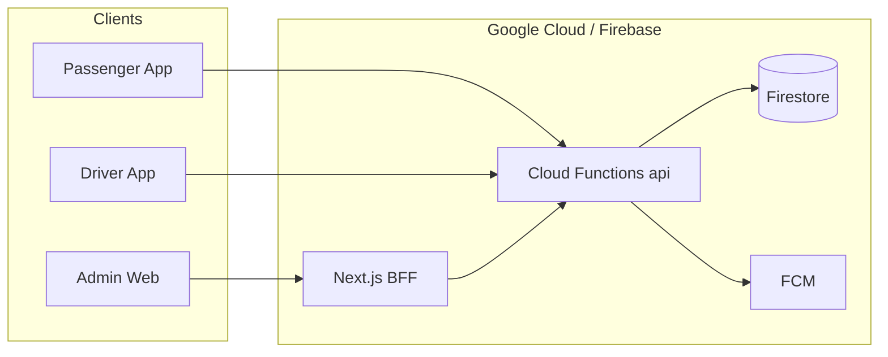
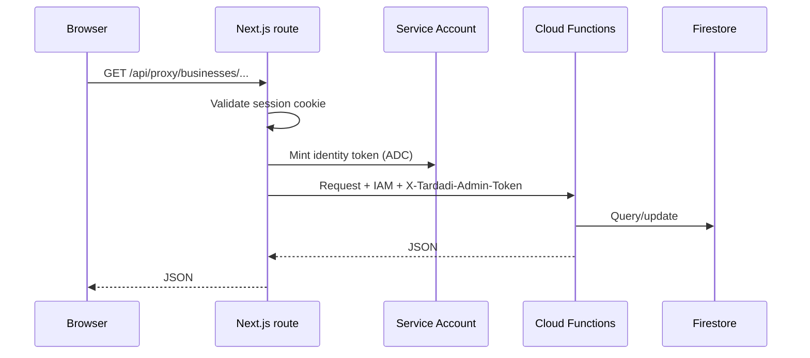

# Architecture

## Overview

TRDDK is a **multi-business** bus operations platform. Each **business** owns drivers, buses, routes, trips, and passenger reminders. A **super admin** manages all businesses; **business admins** manage one tenant.

## Applications

### Passenger (`apps/passenger`)

- Flutter UI for route discovery, live map, reminders, phone verification flow.
- Calls Cloud Functions **directly** (no BFF).
- Uses `tardadi_core` for API, map tiles, branding, FCM registration.

### Driver (`apps/driver`)

- Flutter UI for login, active trip, GPS upload, route map.
- Calls Cloud Functions directly.
- Trip lifecycle: `POST /api/trips/start`, `POST /api/gps`, `POST /api/trips/arrived`, `POST /api/trips/end`.

### Admin (`apps/admin`)

- Next.js 15 App Router with server routes under `src/app/api/`.
- **BFF pattern:** browser never holds Cloud Functions IAM tokens; server routes use `fetchBackend()` (`src/lib/backend.server.ts`) with Application Default Credentials or configured service account on App Hosting.
- **Proxy:** `/api/proxy/*` forwards to backend with allowlist (`src/lib/env.server.ts` → `ADMIN_PROXY_ALLOWLIST`).
- Auth session: HTTP-only cookie (`SESSION_COOKIE`) with admin JWT payload for UI; backend calls use `X-Tardadi-Admin-Token` when Cloud Run consumes `Authorization` for IAM.

### API (`firebase/functions`)

- Single Gen2 HTTPS function `api` mounting Express app (`src/index.ts`).
- Routes under `src/routes/*.ts`, auth in `src/auth/`.
- Firestore access via Firebase Admin SDK (bypasses client rules).
- Secrets: `ADMIN_JWT_SECRET`, `SUPPORT_EMAIL` (Secret Manager in production).

## Shared packages

### `@tardadi/shared` (`packages/shared`)

TypeScript source of truth for:

- Domain types (`Business`, `Route`, `Trip`, …)
- Collection name constants
- RBAC helpers
- Shared API client for Admin client-side (non-secret calls)

Built to `dist/`; vendored into Functions and App Hosting deploy trees.

### `tardadi_core` (`packages/tardadi_core`)

Flutter shared library:

- `TardadiApi` HTTP client
- Map configuration (Carto fallback tiles)
- FCM service wrapper
- Theme / brand tokens
- Route polyline utilities

## Authentication and authorization

| Actor | Mechanism | Scope |
|-------|-----------|-------|
| Super admin | Username/password → JWT | All businesses |
| Business admin | Username/password → JWT | Single `businessId` |
| Driver | Phone OTP flow → driver token | Assigned business |
| Passenger | Phone verification (app flow) | Read public route/trip data via API |

RBAC enforced in Functions middleware (`src/auth/middleware.ts`, `src/auth/scope.ts`). Firestore rules (`firebase/firestore.rules`) enforce read/write for client SDK if used; primary writes go through Admin SDK in Functions.

## Admin BFF data flow

## Maps

| Layer | Admin | Mobile |
|-------|-------|--------|
| Preferred | Google Maps JS (`MapViewGoogle`) when `NEXT_PUBLIC_GOOGLE_MAPS_*` set | `flutter_map` + configurable tiles |
| Fallback | Leaflet + Carto CDN (`mapConfig.ts`) | Carto Voyager in `tardadi_core` |

Server-side geocoding/routing in Admin uses `GOOGLE_MAPS_API_KEY` (`geocode.server.ts`, `routing.server.ts`). Functions expose `POST /api/routing/route` for road geometry.

**Production note:** App Hosting env must include Google Maps variables or Admin falls back to Carto (may show API key watermark).

## FCM

- Flutter apps register device tokens via `tardadi_core` FCM service.
- Functions can send notifications (passenger reminders, trip events) when configured.
- **APNs** for iOS push requires Firebase console + Apple developer setup (not fully documented in repo — treat as deployment task).

## Key technical decisions

1. **Monorepo** with npm workspaces + path Flutter packages.
2. **Single Functions codebase** bundled with esbuild for deploy reliability.
3. **No public Cloud Run invoker** — org policy expects authenticated service-to-service calls from Admin BFF.
4. **Business-scoped data** under `businesses/{id}/…` (legacy name `organizations` alias in constants only).
5. **App Hosting staging directory** — deploy copies `apps/admin` → `apphosting-staging/` with vendored shared package.

## Related docs

- [setup.md](setup.md)
- [api.md](api.md)
- [firestore.md](firestore.md)
- [security.md](security.md)
- [deployment.md](deployment.md)
